# QuickQuote bug hunt — overnight report

**App tested:** `index.html` on `master` @ `e40b481` ("Remove Print button; move Lists into a top-bar overflow menu")
**How:** served locally (`python3 -m http.server`) and driven with Playwright 1.56 + headless Chromium using iPhone viewports **390×844** and **375×667** with an iOS Safari user agent, `isMobile`, touch and 2× DPR. The scripts are in [`reports/scripts/`](scripts/). They use absolute paths from the test box; run them with `node reports/scripts/hunt.js` while serving the repo on port 8765.
**No app code was changed.**

> **Limitations.** Only Chromium is installed, not WebKit. iOS-only behaviour (number-input parsing, `window.print()` from a Home Screen app, `mailto:`, the on-screen keyboard over `position:fixed`, speech recognition) was emulated where possible and otherwise worked out from the code and known WebKit behaviour. Those items are marked **(iOS — verify on device)**.

**Console:** no JavaScript errors or uncaught exceptions in any flow. The only console output was one warning that my comma-input test (#8) caused on purpose. I also tried HTML/script injection in the job name, notes, company and sub names: `esc()` is applied correctly everywhere and nothing executed.

---

## Summary — fix these first

| # | Severity | Issue |
|---|---|---|
| 1 | 🔴 Money / business | Shared estimate and PDF show the client **your costs, profit and margin** |
| 2 | 🔴 Lost data | Typed labor amounts get **wiped or overwritten** by auto-calc (changing days, rate, sub, or any rate in Lists) |
| 3 | 🔴 Lost data | A sub's saved daily rate is **silently reverted** by any keystroke in an open estimate |
| 4 | 🔴 Lost data | Deleting a company or sub **erases it from every estimate** that used it, next time that estimate is touched |
| 5 | 🔴 Money | Qty **0 is counted as 1** (shows 0, charges 1) |
| 6 | 🔴 Money | Price-book autofill **locks in the wrong price** (e.g. typing `2x4 8' PT` gets the `2x4 8'` price) |
| 7 | 🔴 Money | Tax is calculated **once** when "Included" is unticked and never updates after that |
| 8 | 🔴 Money (iOS) | Typing `3,000` in any number field is **saved as $0** on iPhone. No numeric keypad (`inputmode`). |
| 9 | 🟠 Money | PDF rounds **unit prices to whole dollars** (`$0.35` → `$0`); line totals rounded |
| 10 | 🟠 Money | Items with a price but no description are **charged but missing** from the PDF and order email |
| 11 | 🟠 Money | Profit ignores tax and delivery paid to the vendor, so **profit is overstated** (needs owner confirmation) |
| 12 | 🟠 Money | Negative numbers accepted everywhere; shown as `$-500` |
| 13 | 🟠 Broken flow | Line-item **Total, 🔍 and × columns are off-screen** on both iPhone widths |
| 14 | 🟠 Broken flow | **No offline support** (no service worker), so the Home Screen app won't open without signal |
| 15 | 🟠 Lost data | No backup or export, and storage-full save errors are **silently swallowed** |

The full details are below, in severity order.

---

## 🔴 Tier 1 — wrong money or lost data

### 1. Client-facing estimate and PDF show internal costs, profit and margin
**Steps:** New estimate → add items → set sub days/rate and managing hours → **Share** (or **Save as PDF**).
**Expected:** a document you can send to the customer: line items, materials total, labor total, grand total.
**Actual:** the document is branded "ESTIMATE" and is the only thing the Share modal produces, but it also contains:
- **"MARGIN 82.5%"** in the grand-total banner
- a **"Sub — 2 days … our cost $800"** line under Labor
- a whole **"INTERNAL — EXPENSES & PROFIT"** section (vendor materials, sub labor, managing labor, total expenses, **Profit $5,445 (82.5%)**)
- "Status: draft"

"Copy Text" has the same problem ("We stand to make: $5,445 (profit margin: ~82%)").

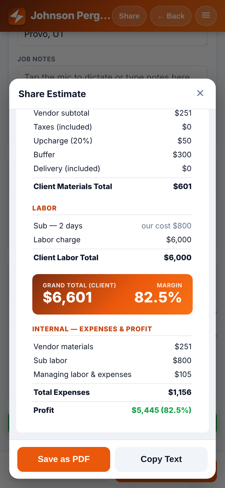
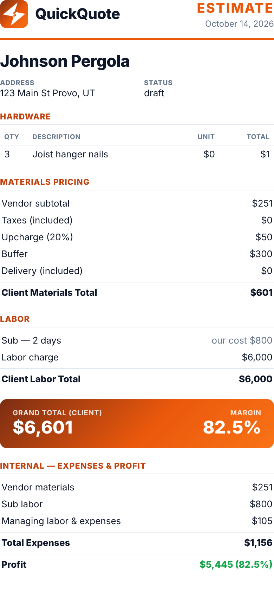

**Where:** `index.html:1534-1539` (labor rows with "our cost"), `:1541-1547` (expRows), `:1561-1564` (MARGIN in banner), `:1565` (internal section), `:1523` (status), and the share text at `:1481-1490`.
**Fix:** split it into two outputs: a **Client estimate** (default for Share/PDF) and an **Internal sheet**. In `buildDocHTML(kind)`, leave out `expRows`, the MARGIN block, the "our cost" span and Status when `kind==='client'`. Do the same for the copy text.

---

### 2. Typed labor amounts are wiped or overwritten by auto-calc
**Steps (A):** New estimate → type **Sub Labor Cost 2400** and **Labor charge 5000** → now type the sub's **Daily Rate 400** (Days still empty).
**Actual:** both fields go blank, and the grand total drops from $7,700 to $300.

| before | after typing the daily rate |
|---|---|
| 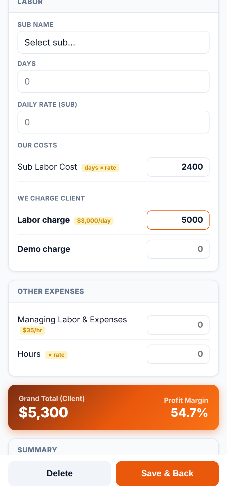 | 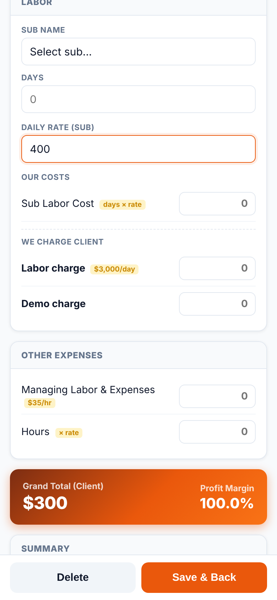 |

**Steps (B):** Days 2 → overwrite Labor charge with **4500** → open ☰ → Subs & Prices → change **Managing labor per hour** (a different setting) → close.
**Actual:** Labor charge is reset to **6000** (2 × $3,000). Changing any rate re-runs every auto-calc on the open estimate. Picking a sub from the dropdown does the same.

**Where:** `recalcLabor()` `index.html:969-977` always writes both `sub-cost` and `cli-labor` (with `''` when days = 0). It is called from `onSubChange()` `:1023` and `updRate()` `:1057-1058`, which runs both recalcs whichever rate changed.
**Fix:** only auto-fill when the inputs that matter are non-zero (`if (days && daily)` for sub cost, `if (days)` for client labor), and track "manually edited" per field (e.g. `lb.cliLabManual = true` set from the field's `oninput`) so auto-calc never overwrites a manual number. In `updRate`, only recalc the field that depends on the key that changed.

---

### 3. A sub's saved daily rate is silently reverted
**Steps:** ☰ → Subs & Prices → add sub **Bob Framing $400/day** → new estimate → select Bob (rate fills 400) → ☰ → change Bob to **$450** → close → type anything in Job Name.
**Expected:** Bob stays $450.
**Actual:** Bob is back to **$400**. Measured: `subs[0].daily` = 450 after the edit, 400 after one keystroke. Opening an *old* estimate and touching any field also resets Bob's master rate to whatever that old job used.

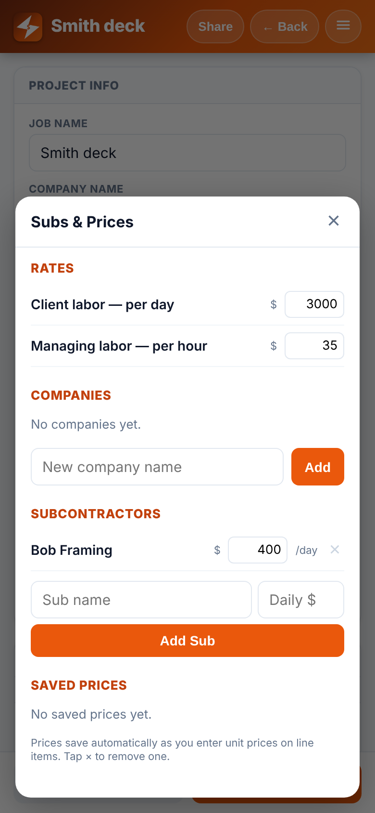

**Where:** `sv()` `index.html:926-930`. It runs on every keystroke in every field and copies the estimate's `sub-daily` into the master sub record.
**Fix:** remove that block from `sv()`. If you want "remember last rate", update the master only from the `sub-daily` field's own `oninput`/`onchange`, and only when the value really changed.

---

### 4. Deleting a company or sub erases it from estimates
**Steps:** estimate uses company **Acme Builders** and sub **Bob** → ☰ → Subs & Prices → tap × on Acme and on Bob → close → type in Notes.
**Actual:** the estimate's stored `company` and `lb.name` become `""` (measured). It happens to any estimate the next time it is opened and edited, with no warning. There is also no rename, so "fixing a typo" means delete and re-add, which wipes the name from old jobs.
**Where:** `populateCompanies()` `index.html:956` and `populateSubs()` `:1003` set the `<select>` to `''` when the name isn't in the list. `sv()` `:886` and `:916` then save that `''`. Deletion is at `rmCompany` `:1075` and `rmSub` `:1098`.
**Fix:** in `populateCompanies`/`populateSubs`, if `selected` isn't in the list, add it as an extra `<option>` (e.g. "Acme Builders (removed)") so it stays selected. Optionally confirm before deleting ("Used by 3 estimates").

---

### 5. Quantity 0 is charged as 1
**Steps:** add an item at $100 → set Qty to **0**.
**Actual:** the field shows 0, but the row total, vendor subtotal and saved data all use **1** ($100). The order email also lists "(1) …" for a qty-0 row.

**Where:** `updItem()` `index.html:1254` (`parseFloat(val) || 1`), and `orderMaterials()` `:1417` (`|| 1`).
**Fix:** `const n = parseFloat(val); e[type][i].qty = isNaN(n) ? '' : Math.max(0, n);`. Treat `''` as 0 in totals and skip qty-0 rows in the order email.

---

### 6. Price-book autofill locks in the wrong price for similar descriptions
**Steps:** with saved prices `2x4 8'` = $4.50 and `2x4 8' PT` = $7.25 → add item → type `2x4 8' PT`.
**Actual:** the price fills **$4.50** as soon as the text reads `2x4 8'`, then stays at $4.50 because autofill only runs while the price is empty. Saved row: `{"desc":"2x4 8' PT","unitPrice":4.5}`. Any description that starts with another saved description has this problem (PT, lengths like `2x4 1`→`2x4 12'`, `H1`→`H1 …`).

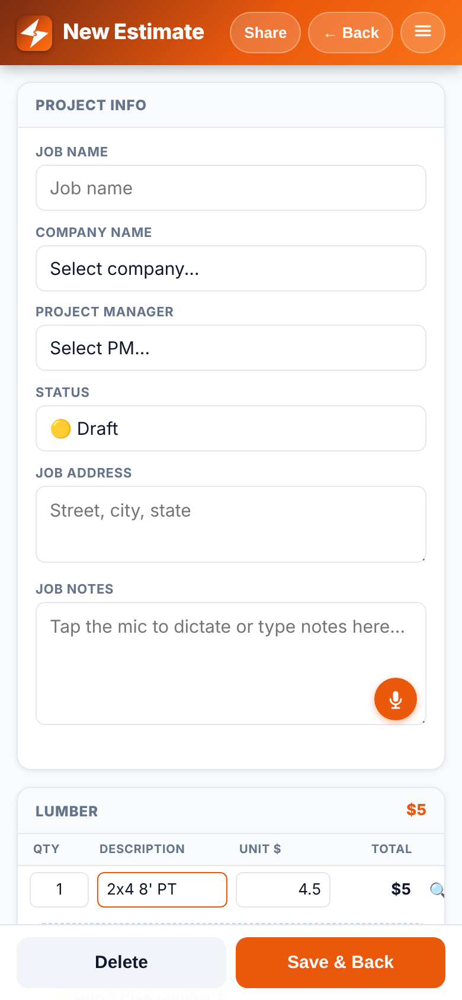

Related: the price book also learns half-typed descriptions. Typing `2x6 10`, then the price, then the closing `'` saved a junk key `"2x6 10"` (measured).
**Where:** `updItem()` `index.html:1262-1270` (autofill on every keystroke) and `:1257-1261` (learn on every keystroke).
**Fix:** autofill on `change`/`blur` of the description, not on `input`. Track `it.autoPriced = true` so a later exact match can replace an auto-filled price, but never a typed one. Learn the price on the price field's `change`.

---

### 7. Tax goes stale
**Steps:** add an item at $1,000 → untick **Taxes · Included** (tax auto-fills **73**) → change qty to 10 (vendor subtotal now $10,000).
**Actual:** tax stays at **$73**. It should be $725.

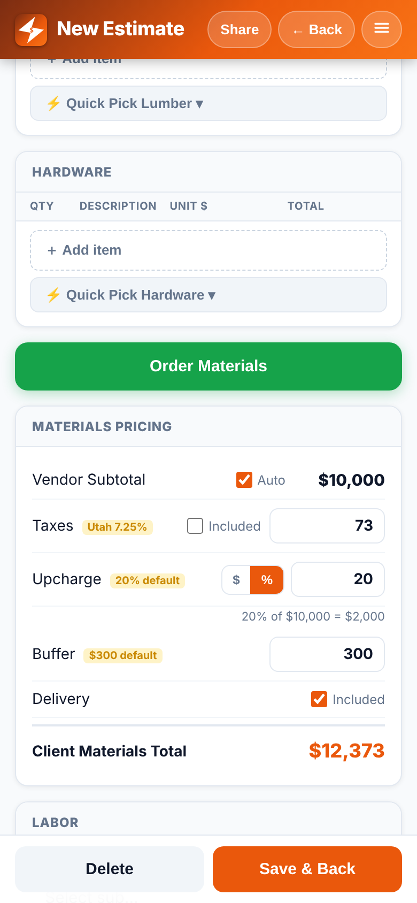

**Where:** `onTaxChange()` `index.html:1112-1124` computes `vS * 0.0725` only when the box is toggled. `rc()` `:1173` then uses the stored number.
**Fix:** store a mode (`p.taxAuto = true`) and compute `tax = round(vendSub * 0.0725)` inside `rc()` (and in `calcGrandTotal`/`showShare`/`buildDocHTML`). Switch to manual only when the user types in the tax field. Hide the "Utah 7.25%" badge once it's manual: it currently stays visible after a manual edit (measured).

---

### 8. iPhone: "3,000" in a number field is saved as $0, and there is no numeric keypad (iOS — verify on device)
**Steps:** on iPhone, type `3,000` in Labor charge (or `1,200.50` in a unit price).
**Actual:** WebKit doesn't block the comma in `type="number"` fields. The field *shows* `3,000`, but `input.value` is `""`, so the app saves **0**. Emulated by setting the value: `value === ""` and saved `cliLab = 0` (measured). None of the 15 number inputs have `inputmode="decimal"`, so iOS shows the full keyboard with a number row instead of the decimal keypad, which makes extra characters easy to type.
**Where:** every `type="number"` input: `index.html:532, 538, 548, 555, 561, 585, 590, 595, 601, 605, 616, 620, 701-702, 717`, plus the generated ones at `:1083, 1107, 1214, 1216`.
**Fix:** add `inputmode="decimal"` to all of them (`inputmode="numeric"` for qty and days). Better still, use `type="text" inputmode="decimal"` with a small parser that strips `$` and `,` (`parseFloat(v.replace(/[$,\s]/g,''))`) so commas work.

---

### 9. PDF and text round unit prices to whole dollars
**Steps:** hardware `Joist hanger nails`, qty 3 at **$0.35**.
**Actual:** PDF shows **Unit $0, Total $1**. A $1,234.56 board shows "$1,235". The rounded line totals don't add up to the subtotal shown.
**Where:** `fmt()` `index.html:757` (`maximumFractionDigits: 0`), used for unit and line totals at `:1514`, `:1462`, `:1469`, `:1212`, `:1273`.
**Fix:** add `fmt2 = n => '$' + Number(n||0).toLocaleString('en-US',{minimumFractionDigits:2,maximumFractionDigits:2})` and use it for unit prices and line totals. Keep whole dollars only for the big summary figures if you like.

---

### 10. Items with a price but no description are charged but not shown
**Steps:** add a hardware row, leave Description blank, enter price **250**.
**Actual:** vendor subtotal includes the $250 ($251 total), but the PDF hardware table shows only the nails row (1 row, measured). The order email skips it too. The customer sees a subtotal that doesn't match the lines.
**Where:** `buildDocHTML()` row filter `index.html:1512`, and `orderMaterials()` `:1416`.
**Fix:** render priced rows with a placeholder ("(no description)"). Better: flag them in the editor (red border) and warn on Share/Order.

---

### 11. Profit ignores tax and delivery the contractor pays the vendor (needs owner confirmation)
**Steps:** $10,000 of lumber → untick Taxes Included ($73, see #7) and Delivery Included ($100).
**Actual:** client materials = vendor + upcharge + tax + buffer + delivery, but **expenses = vendor + sub + managing labor only**. If "not included" means the vendor bills tax and delivery on top, that money is a real cost and profit is overstated by it.

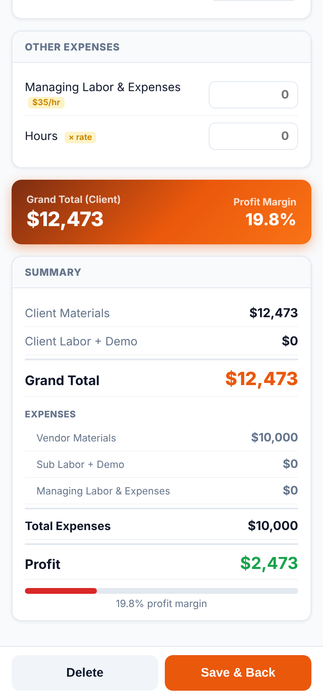

**Where:** `rc()` `index.html:1183`, duplicated in `showShare()` `:1448` and `buildDocHTML()` `:1507`.
**Fix:** if tax/delivery are pass-through costs, add `taxAmt + delAmt` to `expenses`. Either way, put the maths in **one** `calc(e)` function. The totals are currently computed four times (`rc`, `calcGrandTotal` `:1377`, `showShare` `:1441-1449`, `buildDocHTML` `:1500-1508`), and those copies will drift apart.

---

### 12. Negative numbers accepted everywhere
**Steps:** qty **-5** at $100, or Buffer **-300**.
**Actual:** vendor subtotal **`$-500`**, grand total **`$-300`**. A negative buffer quietly cuts the price. `min="0"` doesn't stop typing.

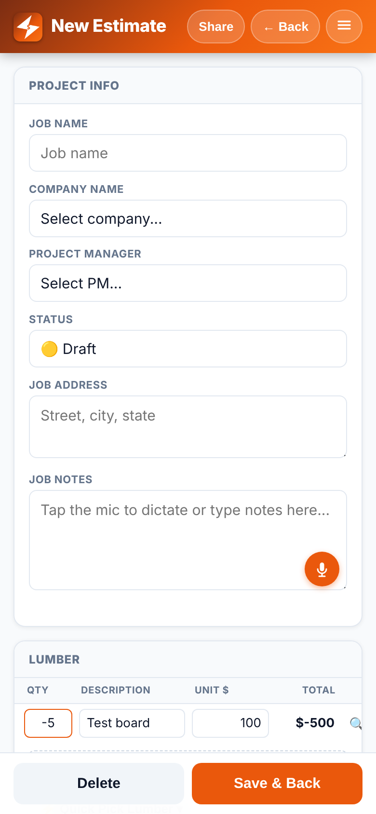

**Where:** all numeric handlers (`updItem` `:1254-1255`, `sv()` `:903-932`). Formatting is in `fmt` `:757`.
**Fix:** clamp to `Math.max(0, n)` in the parser from #8. If you want negative lines for credits, format them as `-$500`, not `$-500`.

---

### 13. Unticking "Auto" vendor subtotal drops it to $0
**Steps:** items worth $500 → untick **Auto** next to Vendor Subtotal.
**Actual:** override field is empty, vendor subtotal becomes **$0**, grand total drops **$900 → $300** straight away.

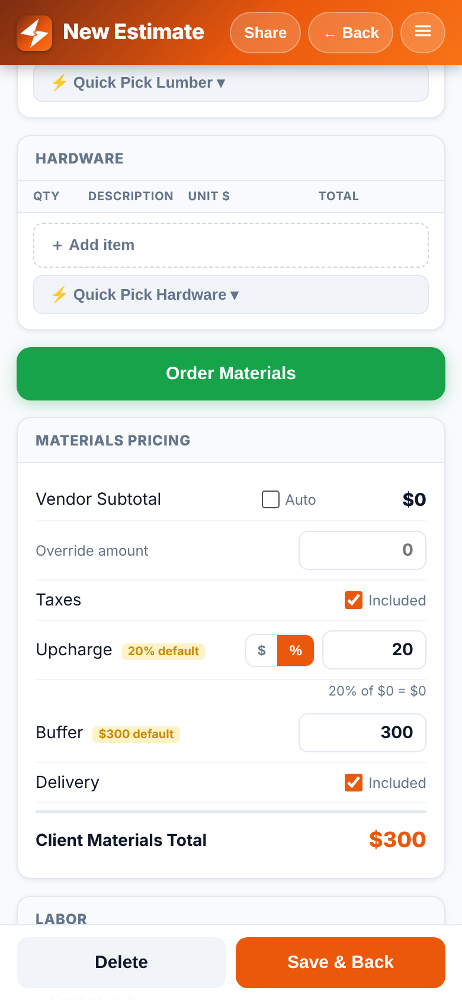

**Where:** `loadForm` `index.html:848`, `sv()` `:905`, `rc()` `:1162`.
**Fix:** when Auto is unticked and `orv` is empty, pre-fill the override with the current auto subtotal.

---

### 14. Upcharge $/% toggle silently changes the meaning of the number
**Steps:** upcharge 20 % on $700 of material → tap **$**.
**Actual:** the 20 now means **$20**, and the total drops **$840 → $770** with no prompt.
**Where:** `setUCMode()` `index.html:1141-1147`.
**Fix:** convert the value when switching (`$ = vendSub × pct/100` and back), or clear it and focus the field.

---

### 15. No backup, and save errors are swallowed
`dbSave()` (`index.html:752`) is `try { localStorage.setItem(…) } catch(e) {}`. If storage is full or blocked, every edit is lost without a word. All estimates, companies, subs and the price book live in one `localStorage` key, with no export or import. If the phone is lost, or the user deletes the Home Screen icon (which clears its storage on iOS), everything is gone.
**Fix:** show a red toast in the `catch`. Add **Export backup** (download or share a `.json`) and **Import** to the ☰ menu.

---

## 🟠 Tier 2 — broken flows

### 16. Line-item Total, 🔍 and × columns are cut off on iPhone
**Steps:** open any estimate, add a line item, at 390 or 375 wide.
**Actual:** the table needs **414 px** but the card gives it 360 (390-wide) or 345 (375-wide). At 390 the × delete button sits at x = 382–402, past the card edge (376) and partly off the screen. At 375 the Total column is clipped and both buttons are fully hidden. You can only reach them by swiping the table sideways, which nothing tells you about. The Description box is squeezed to **110 px**, which fits about "Pressure treate…".

| 390 wide | 375 wide |
|---|---|
| 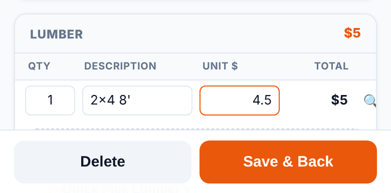 | 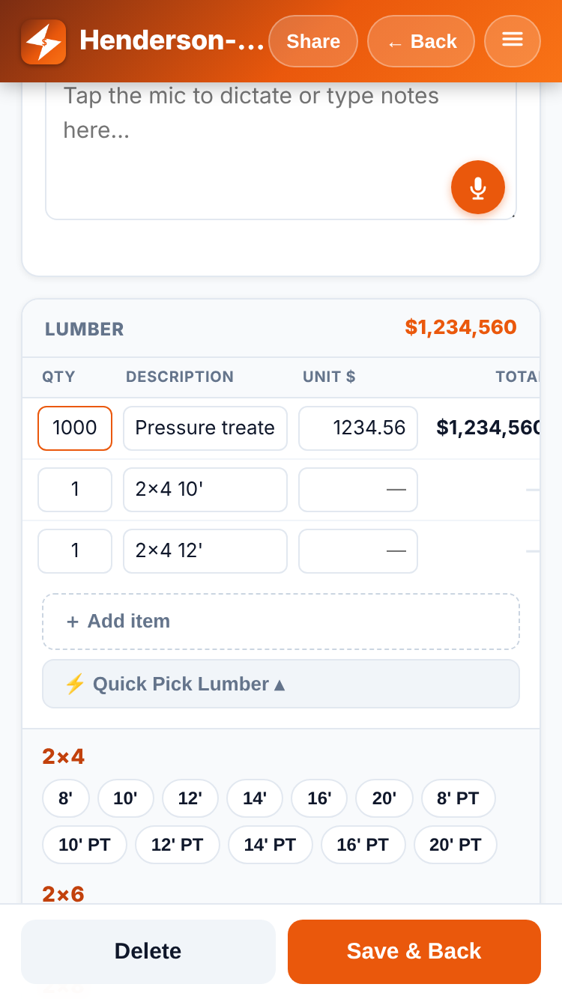 |

**Where:** header widths `index.html:331-335` (54+88+74+66 fixed, plus description `min-width:110px` at `:1215`), cell CSS `:83-91`, wrapper `overflow-x:auto` `:328`/`:433`.
**Fix:** on phones, use a 2-line row instead of a 5-column table: line 1 = description (full width) + ×; line 2 = qty · unit $ · total · 🔍. Or a CSS grid with `grid-template-columns: 44px 1fr 72px 28px` and the total under the price. Either way the × must be visible without scrolling.

### 17. Doesn't work offline (no service worker)
The manifest is set up for a Home Screen app, but there is no service worker (`navigator.serviceWorker.controller === null`, no `serviceWorker.register` in the file). Opened from the Home Screen in a basement or on a rural job site with no signal, iOS shows "Safari cannot open the page", and the app's data can't be reached.
**Where:** nothing yet. Add it near `index.html:1590`.
**Fix:** add a ~15-line `sw.js` that pre-caches `index.html`, `manifest.json` and the icons (cache-first), and register it at boot.

### 18. Line-item delete: no confirmation, no undo, tiny target next to 🔍
Tapping × deletes the row instantly (no dialog, measured). The × hit area is **20×20 px** and sits right next to the 🔍 lookup (**23×14 px**). Aiming for one hits the other, and a wrong tap deletes a priced row for good.

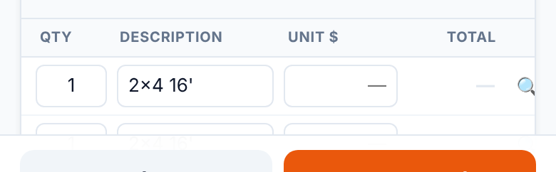

**Where:** `index.html:1218` (buttons), `:88-91` (CSS), `rmItem` `:1244-1249`.
**Fix:** make both at least 44×44, separate them, and show an "Item removed · Undo" toast (keep the spliced item for 5 s).

### 19. Quick Pick chips: keyboard pops up, and chips jump on every tap
**Steps:** open Quick Pick Lumber → tap `16'` → tap `16'` again.
**Actual:** each tap adds a new row (2 rows, not qty 2) and **moves focus to that row's price field**. On iPhone that opens the keyboard every time, and the new row pushes the chip grid **down 40 px** (measured y 485 → 525), so the next tap lands on the wrong chip.
**Where:** `addItem()` `index.html:1232-1237` (focus), `quickAdd` `:1240-1242`.
**Fix:** don't focus when adding from a chip. If the same description already exists, bump its qty instead of adding a row. Show a brief "✓ 2x4 16' ×2" toast on the chip.

### 20. Share preview and PDF layout break on phone widths
At 375 wide, the preview content is **503 px** wide inside a 343 px box, so it scrolls sideways. The "QuickQuote" name runs into the "ESTIMATE" title, and a long company name runs off the right edge. The **address loses its line breaks** ("123 Main St Provo, UT") because `.doc-meta` doesn't keep newlines.

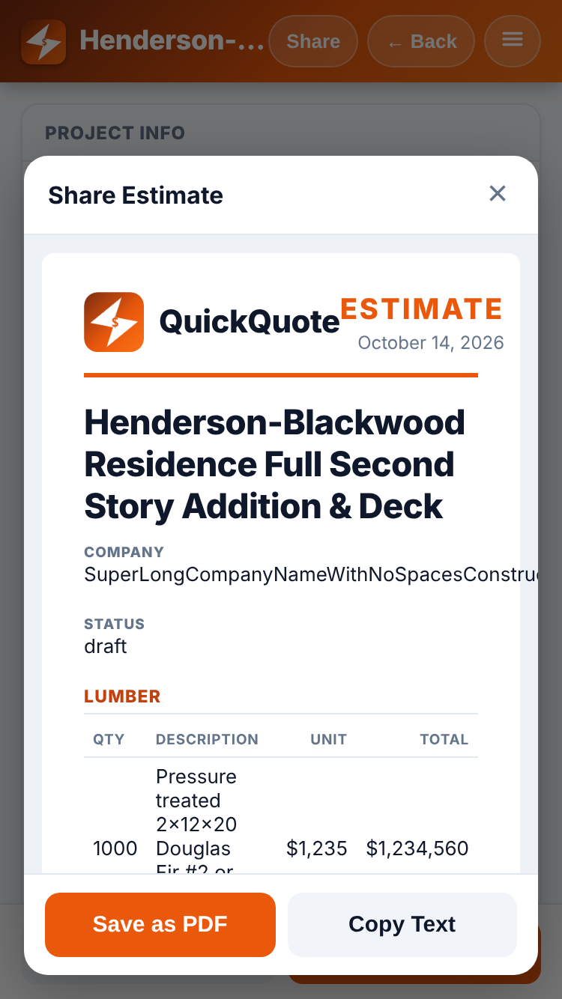

**Where:** `.doc-head`/`.doc-wrap` `index.html:196-203`, `.doc-meta` `:205`, address cell `:1522`.
**Fix:** reduce `.doc-wrap` padding on small screens. Add `flex-wrap:wrap; gap:8px` to `.doc-head`, `overflow-wrap:anywhere` to `.doc-meta > div` and `.doc-job`, and `white-space:pre-line` on the address.

### 21. List view scrolls sideways with a long company name, and the total overlaps
With a company name that has no spaces, the page becomes **390 px wide on a 375 screen** (horizontal scroll), and the meta line runs under the total.

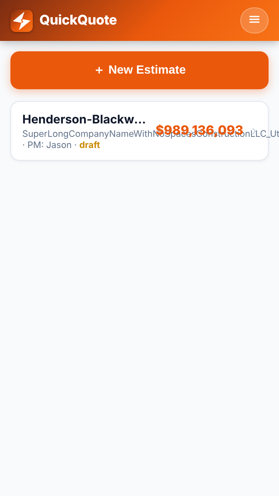

**Where:** `.ec-meta` `index.html:43` (no wrapping rules), card layout `:38-45`.
**Fix:** `.ec-meta{overflow-wrap:anywhere;}` or `white-space:nowrap;overflow:hidden;text-overflow:ellipsis;`.

### 22. "Save as PDF" on iPhone (iOS — verify on device)
- `printDoc()` (`index.html:1568-1571`) calls `window.print()`. In iOS **Home Screen (standalone) mode** this has been unreliable or a no-op in many iOS versions. Test on the real phone. A fallback is to build the PDF client-side, or open the doc in a new tab and have the user use the Share sheet.
- The PDF is always titled **"QuickQuote"** (`document.title`, measured), so every saved file is `QuickQuote.pdf`. Set `document.title = 'Estimate – ' + e.client` before printing and restore it afterwards.
- The date on the document is **today's date** (`:1510`), not the date the estimate was made. Re-sharing an old quote re-dates it, and there is no estimate number. Store `createdAt` in `newEst()` (`:796-809`).
- Printing from Safari's own Share → Print (not the button) gives a **blank page**, because `#doc` is only filled inside `printDoc()`. Fill it in `showShare()` too.

### 23. "Share" doesn't share
The Share button opens a preview with "Save as PDF" and "Copy Text" only. There is no `navigator.share` call (measured), so sending to a customer takes copy → switch app → paste. On iOS, `navigator.share({title, text})` opens the native share sheet (Messages, Mail, AirDrop).
**Where:** `index.html:681-684`, `copyShare` `:1575-1582`.
**Fix:** add a primary "Send…" button that uses `navigator.share` when available and falls back to copy.

### 24. "+ New Estimate" leaves "$300 Untitled Estimate" entries behind
Tapping New Estimate saves a record straight away. The defaults (buffer $300, upcharge 20 %) give it a **$300 grand total and 100 % margin** before anything is entered, and backing out leaves "Untitled Estimate — $300" in the list.

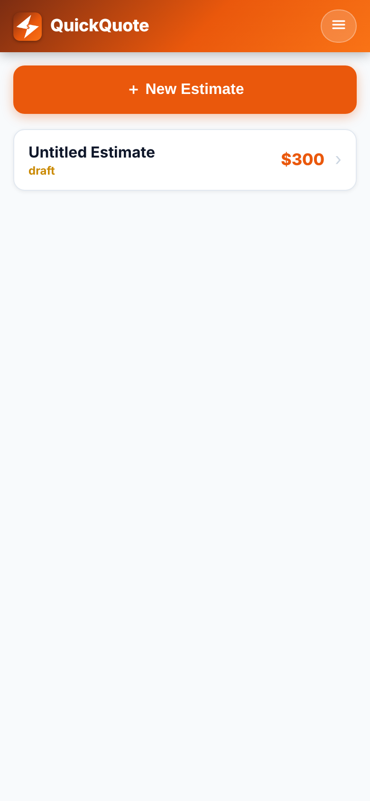

**Where:** `newEst()` `index.html:796-809`, `goList()` `:773-781`.
**Fix:** in `goList()`, delete the current estimate if it has no name, items or labor. Alternatively, apply the buffer only once there is a vendor subtotal.

### 25. Other smaller flow bugs
- **PM "Other…" with no name is lost on reopen.** It reverts to "Select PM…" (measured), at `loadForm` `:830-838` / `sv()` `:888-890`. Store a `pmIsOther` flag.
- **Clearing Hours leaves the old managing-labor amount** (hours "" but amount 140, measured), at `recalcMgmt()` `:983` (`if (hrs)`). Clear the amount too when it was auto-filled.
- **The page behind a modal still scrolls** (scrollY 395 → 995 while Share was open, measured). Set `body{overflow:hidden}` while `#share-modal`/`#manage-modal` is `.on`, or use `overscroll-behavior:contain` on the modal (`:154`, `:171`).
- **Voice notes in a Home Screen app (iOS — verify on device).** `webkitSpeechRecognition` (`:1310-1363`) has historically been unavailable inside standalone web apps, and users get the "requires Safari on iOS 14.5+" alert even though they are on Safari. Reword it to "Use the 🎤 key on the iPhone keyboard".
- **Fixed bottom bar and the keyboard (iOS — verify on device).** `#bot-bar` is `position:fixed; bottom:0` (`:147`). In iOS Safari it can ride up over the field being edited, or jump around while the keyboard animates. Headless Chromium can't reproduce this. Consider hiding it on `focusin` of inputs.

---

## 🟡 Tier 3 — UX polish

### 26. Tap targets below 44×44 pt (Apple HIG)
Measured: line-item × **20×20**, 🔍 **23×14**, checkboxes **15×15** (`:118`), $/% toggle **27×26** (`:120`), Quick Pick chips **32×26** (`:104`), modal close × **22×24** (`:159`), header buttons 35 px high (`:26`). Fix: `min-height:44px` / padding on these, and make the whole "☐ Included" label the hit area (it already is a `<label>`, so just add padding).

### 27. Colour contrast below WCAG AA (4.5:1 for normal text)
| element | ratio |
|---|---|
| white on brand orange `#ea580c` (New Estimate, Save & Back, Save as PDF) | **3.56** |
| white on green `#16a34a` (Order Materials) | **3.30** |
| yellow badge `#ca8a04` on `#fef3c7` ("20% default", "$35/hr"…) | **2.64** |
| "draft" status `#ca8a04` on white (list) | **2.94** |
| empty-total dash `#e2e8f0` on white | **1.23** (invisible) |
| × delete `#cbd5e1` on white | **1.48** |
| 🔍 `#94a3b8` on white | **2.56** |

Fix: use `--brand-dk #c2410c` for button backgrounds (≈5.2:1 with white), green `#15803d`, badge text `#854d0e`, and darken the × to `#94a3b8` or darker.

### 28. Input font sizes depend on disabling zoom
Inputs are 13–15 px (`.finp` 15, `.iinp` 13, `.pinp` 14, `.sub-rate` 13). iOS zooms in on any focused input under 16 px. That doesn't happen here only because the viewport sets `maximum-scale=1, user-scalable=no` (`:5`), which also blocks pinch-zoom on Android (an accessibility problem). Fix: set inputs to `font-size:16px` and drop `maximum-scale`/`user-scalable`.

### 29. Invalid CSS: list bottom padding ignored
`#list-view{padding-bottom:calc(env(safe-area-inset-bottom,0px)+14px)}` (`:33`) has no spaces around `+`, so the whole `calc()` is invalid and dropped. The computed padding-bottom is **0px** (measured), so the last card sits on the home-indicator bar. Fix: `calc(env(safe-area-inset-bottom,0px) + 14px)`. Also add the safe-area bottom to the modals' `padding` (`:154`, `:171`).

### 30. Status emoji not shown on list cards
The status dropdown shows 🟡🔵🟢✅, but list cards only show the lower-case word ("approved"), and "completed" is purple even though its emoji is ✅. The `.ec-icon` style (`:40`) is defined but never used.

**Where:** `renderList()` `:1393-1405`. Fix: put the emoji in an `.ec-icon` div at the start of the card and capitalise the label.

### 31. Confusing wording and labels
- **"Taxes ☑ Included" / "Delivery ☑ Included"** is a double negative: ticked means $0 is added. Contractors read "Included" as "include tax in the price". Consider "Add tax ☐" / "Charge delivery ☐" (`:536-537`, `:559-560`).
- The Summary label **"Sub Labor + Demo"** (`:650`) shows only sub cost, because demo is a client charge and is not in that figure (`:1181`). Rename it to "Sub Labor".
- Share text says "**1 days**" (`:1482`).
- Empty fields show a grey **"0" placeholder** that looks like a real value (e.g. Days "0", Labor "0"). Use "—" or leave it blank.
- A saved price of **$0** shows as an empty field in Subs & Prices, because `esc(0)` → `''` (`:758`, `:1107`).

### 32. Lists (Subs & Prices) modal
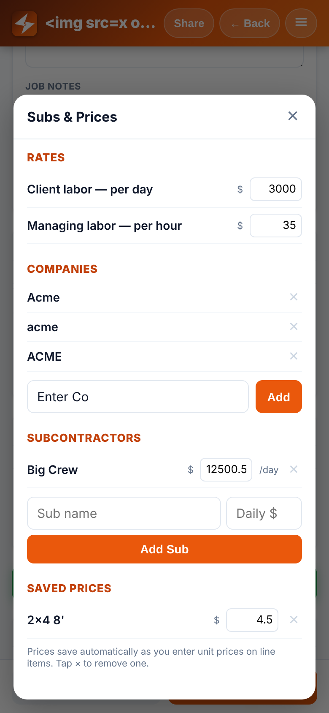
- **Enter doesn't add** a company or sub (no `<form>`) (`:707-719`).
- **Case-sensitive duplicates:** "Acme", "acme" and "ACME" all get added (measured), at `addCompany` `:1068-1074`.
- **Rate inputs are 62 px wide** (`:187`), which fits about "12500.5" with nothing to spare.
- **Rates save on `change` only** (`:701-702`). If the app is backgrounded mid-edit, the value is lost. Use `oninput`.
- **No rename** for companies or subs (see #4). **PM names are hard-coded** in HTML (`:285-292`) and can't be edited in Lists.
- **The ☰ menu has one item** ("Subs & Prices") (`:245-247`). It's a natural home for Export/Import (#15), PM list, and "About/version".

### 33. Bottom bar layout
**Delete** gets the same weight as **Save & Back** and sits right next to it (`:667-670`). There is a `confirm()`, but a smaller red-text "Delete" (or moving it to the ☰ menu) would prevent scares. "← Back" in the header and "Save & Back" do the same thing, since everything autosaves. Consider renaming the bottom button to "Done".

### 34. Header with a long job name
The title truncates fine ("Henderson-Bl…"), but with three pills there is room for only about 12 characters at 375 wide.

Consider an icon-only Share button (`:241`).

---

## What worked well
- Autosave on every keystroke. Reloading kept all **41 line items** and every field (measured).
- 40+ line items added and rendered with no slowdown and no console errors.
- HTML escaping is consistent. No injection through names, notes, companies or descriptions.
- Order Materials builds a clean `mailto:` (subject `Material Order – <job>`, greeting with PM, address, LUMBER/HARDWARE bullets).
- Huge totals ($989,136,093) fit inside the grand-total banner at 375 wide.

## Screenshot index
All files are in `reports/screenshots/` (2× DPR):
`01-first-launch-390`, `01b-new-estimate-empty-total`, `01c-list-untitled-300`, `02-qty-zero-counts-as-one`, `02b-negative-qty-accepted`, `03-prefix-autofill-wrong-price`, `04-stale-tax`, `04b-expenses-exclude-tax-delivery`, `05a-labor-before`, `05-manual-labor-wiped`, `06-sub-rate-reverted`, `07-share-modal`, `07b-share-internal-profit-visible`, `07c-print-media`, `10-line-items-{375,390}`, `10b-huge-total-{375,390}`, `10c-header-long-title-{375,390}`, `10d-list-long-{375,390}`, `10e-share-{375,390}`, `11-many-items`, `11b-tiny-row-buttons`, `12-list-status-no-emoji`, `12b-override-zeroes-vendor`, `14-delete-button-offscreen`, `14b-after-sideways-scroll`, `15-lists-modal`, `16-top-menu`.
